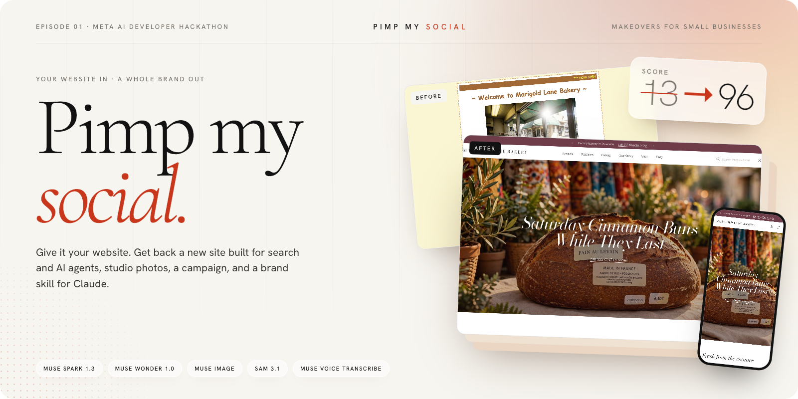
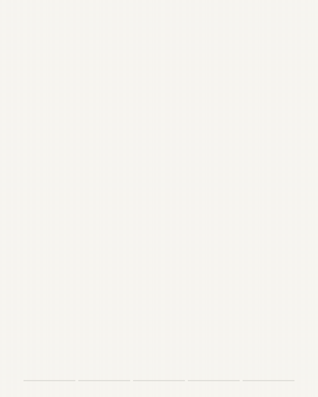
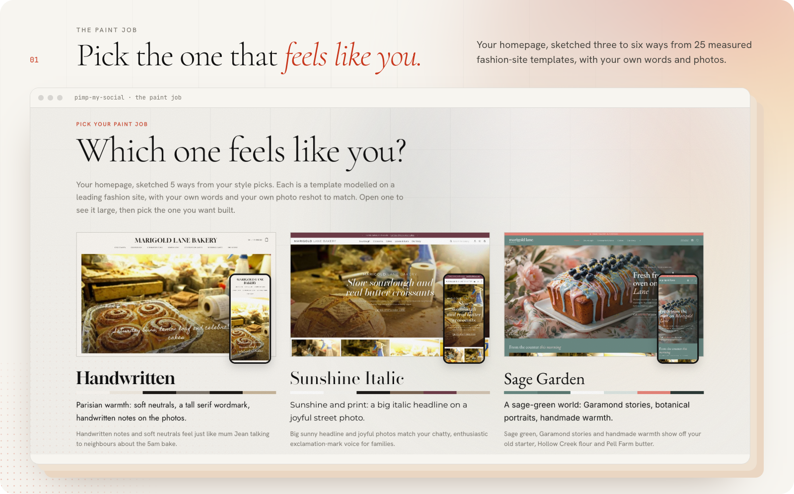
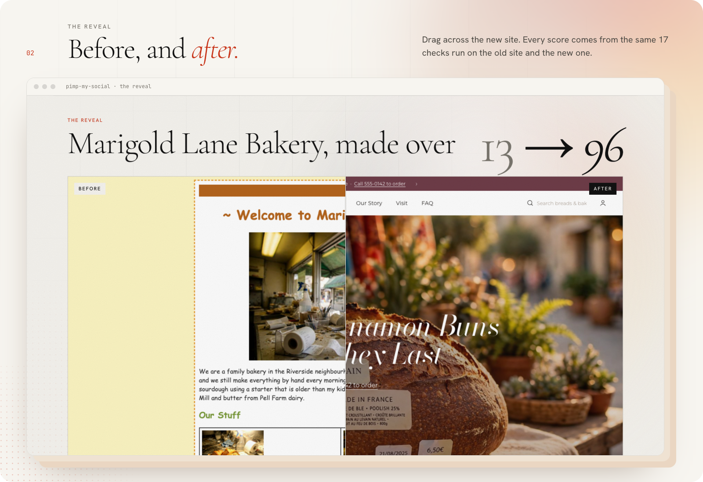
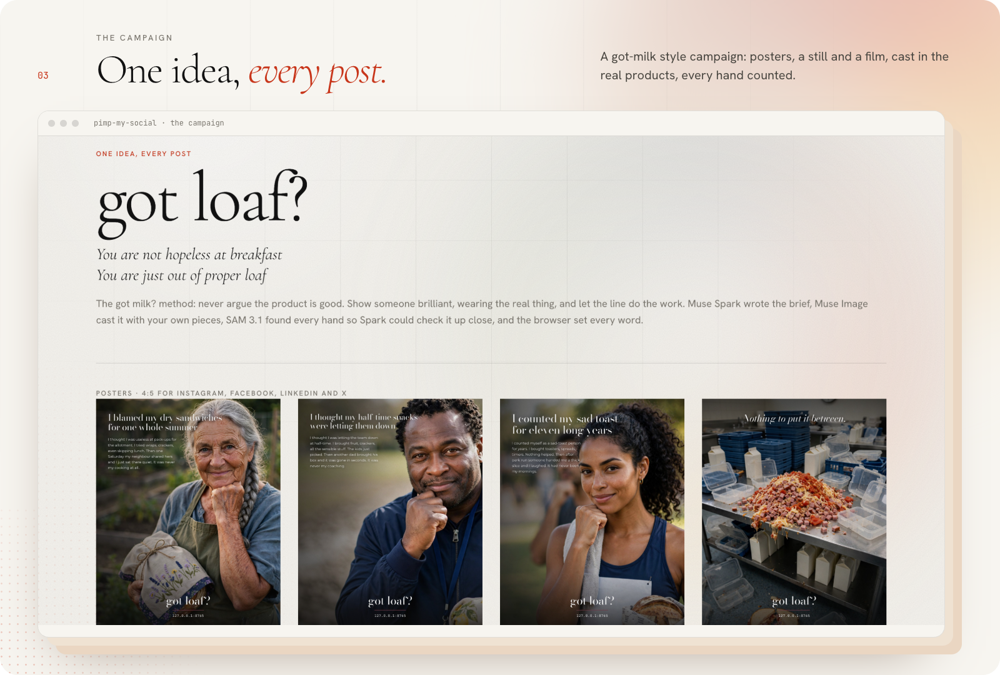
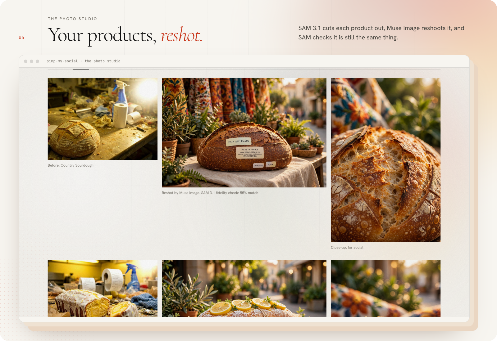
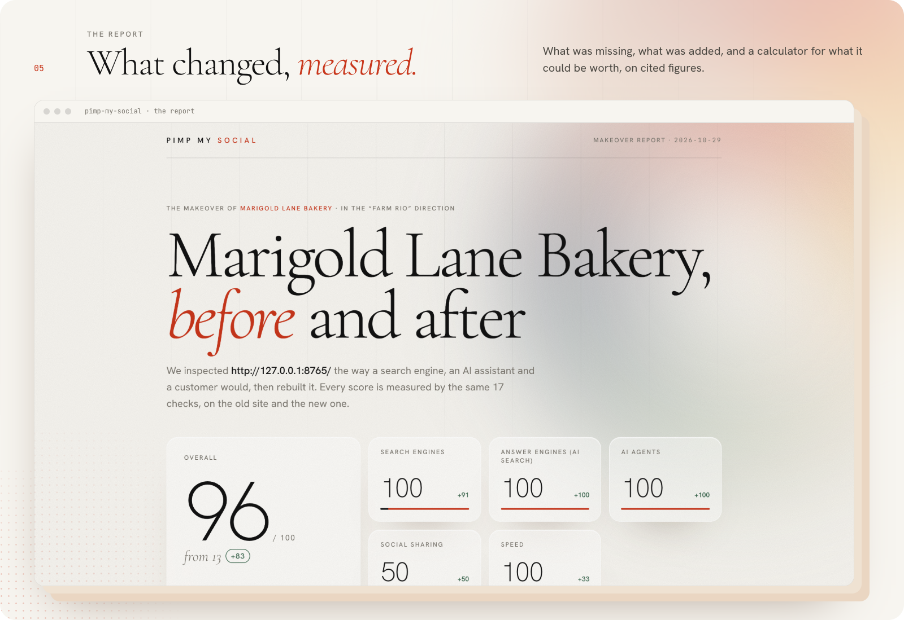
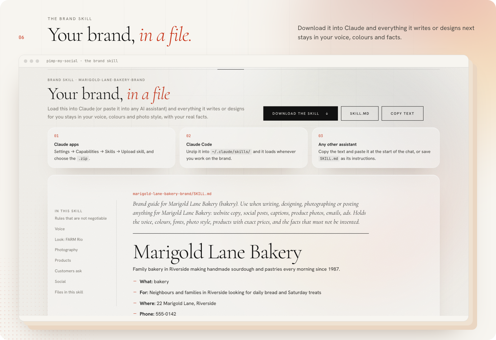
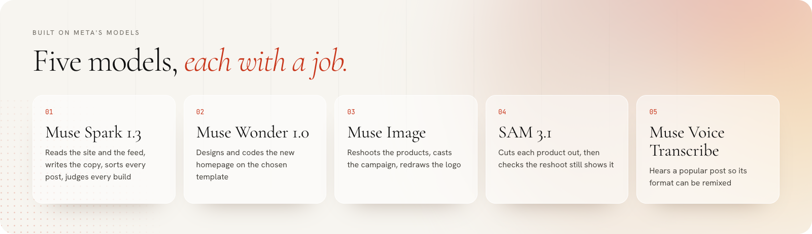

<p align="center">
  
</p>

<p align="center">
  <b>Give us your website. We'll give you back a makeover.</b><br>
  <sub>Built for the Meta Global AI Developer Hackathon, Indie track · Oct 26 to Nov 4, 2026</sub>
</p>

<p align="center">
  <a href="https://pimpmysocial.loreto.io"><b>Open the showroom ↗</b></a> ·
  <a href="#what-you-get">What you get</a> ·
  <a href="#how-it-works">How it works</a> ·
  <a href="#run-it">Run it</a> ·
  <a href="#under-the-hood">Under the hood</a>
</p>

<br>

A small business types in its URL, and, if it likes, its Instagram or online shop. Pimp My Social inspects
the site the way a search engine, an AI assistant and a customer would, scores what's missing, and rebuilds it:

- **a new editorial website** modelled on real premium brand sites, built for search engines, AI answers and AI agents
- **studio photos of their own products**, reshot and checked so the product never changes
- **a campaign** in the Got Milk register, with posters, a still and a film
- **a report** on what changed and what it could be worth
- **a brand skill** to download into Claude, so whatever AI writes or designs next stays on brand

It is named for the show where a crew takes a beat-up car and hands back something unrecognisable.

<p align="center">
  
</p>

## What you get

<p align="center"></p>
<p align="center"></p>
<p align="center"></p>
<p align="center"></p>
<p align="center"></p>
<p align="center"></p>

<sub>Every screen above is a real run on <b>Marigold Lane Bakery</b>, a fictional business made for this demo (<code>demo/marigold-lane/</code>), so no real business is made over without asking.</sub>

## How it works

<p align="center"></p>

1. **Paste a link.** The page recognises Instagram, TikTok, Etsy, Pinterest and more as you type, and reads the
   site's own linked Instagram anyway.
2. **The garage.** The site is rendered like a visitor, a search engine and an AI agent see it, and scored on 17 checks.
   Muse Spark reads the pages, the feed and the shop's catalogue into a grounded brand profile.
3. **The paint job.** Your style picks shortlist 25 measured templates; Muse Wonder sketches your homepage in three to six of them. You pick one.
4. **The build.** The site, photos, logo, campaign and posts are made, and each is checked by a second model before you see it.
5. **The reveal.** Before and after, side by side, with a downloadable kit: the site, photos, posts, report and brand skill.

<details>
<summary><b>Every Meta model's job, stage by stage</b></summary>

<br>

| Stage | Model | What it does |
|---|---|---|
| Your feeds | **Muse Spark 1.3** (vision) | Reads the owner's latest Instagram posts (and the shop's full Shopify catalogue) and sorts every post, picture and caption together: a product on its own, a product being worn, an event, behind the scenes, an announcement, someone else's post. Only the product shots join the brand read, so the makeover covers what they really make, not just what the homepage shows |
| Inspection | **Muse Spark 1.3** (vision) | Reads the before screenshots, photos and pages into a grounded brand profile: products matched to photos, prices as stated, voice, FAQs, gaps |
| Paint job | **Muse Spark 1.3** + **Muse Image** + **Muse Wonder** | the owner's style tags shortlist 25 fashion-site templates; Spark picks 2-5 plus a random wildcard; Image reshoots a product in each look; Wonder sketches their homepage in each, with a different headline, lead product and twist every time; the owner picks from the thumbnails |
| Photo studio | **SAM 3.1** + **Muse Image** | SAM isolates each product from the owner's photo; Image reshoots it (set, light, lens, depth of field); SAM finds it again in the result and scores fidelity, so a reshoot that changed the product is caught |
| Logo | **Muse Spark** + **Muse Image** | Spark reads what the current logo is about; Image redraws it as one clean mark; Spark compares old and new and rejects a redraw that lost the idea |
| Website | **Muse Spark** + **Muse Wonder 1.0** | Spark writes the copy, held to the facts on the site; Wonder builds the page on the chosen template from its skill and screenshots; Spark screenshots the result and scores it against the template side by side, and Wonder revises below 8/10 |
| Findability | code | Meta/Open Graph, JSON-LD (business, products, FAQ), robots.txt that welcomes AI crawlers, sitemap.xml, llms.txt, WebMCP tools |
| The campaign | **Muse Spark**, **Muse Image**, **SAM 3.1** | A "got ___?" campaign in the Got Milk register, ported from the Loreto "got skills?" work: Spark writes one thesis ("You are not X. You are Y.") and a brief (a poster roster, a deprivation still, a four-beat metaphor film), code gates the copy; Image casts it, wearing the real products, with one cast reference passed into every film shot so the person stays the same; SAM finds every hand so Spark can count fingers; the browser sets all type; Spark watches the film and one revision follows its notes |
| Remix a hit (optional) | **Muse Spark** (video), **Muse Voice Transcribe**, Muse Image | A popular post is reverse engineered into its essence (Spark watches it, Transcribe hears its speech), then rebuilt with only this business's products, prices and place; Image shoots any new angle the format needs; Spark reviews each cut against the format |

</details>

## Run it

```bash
uv sync
# put MODEL_API_KEY in .env (dev.meta.ai/platform -> API keys)
uv run scripts/smoke.py      # one live call per Meta model
uv run pytest -q             # offline tests, no API calls

uv run scripts/serve.py --demo                                  # http://localhost:8000
(cd demo/marigold-lane && python3 -m http.server 8765 --bind 127.0.0.1)
# in the page: http://127.0.0.1:8765/  -> Pimp it
```

Hosted at [pimpmysocial.loreto.io](https://pimpmysocial.loreto.io) as a showroom: finished makeovers open for
anyone, and a live makeover (which spends API credit) needs an access code. The settings are in
`server/app.py`'s docstring, and `scripts/showroom.py` picks which finished runs are on show.

`--demo` sets `PMS_ALLOW_PRIVATE=1` so the crawler can reach the local demo site. Never set it in production:
by default the crawler refuses private and local addresses. Playwright drives the installed Google Chrome
(`channel="chrome"`), so no browser download is needed.

```bash
uv run scripts/record_demo.py http://127.0.0.1:8765/            # a full makeover as video: out/demo/<name>.mp4
uv run scripts/readme_art.py <finished job> --picker <job at the picker>   # these README images
```

## Under the hood

### The inspiration library (`inspo/`)

A skill folder future makeovers build from:

- `inspo/templates/`: **the directions.** 25 template skills, one per site in Linguise's
  "Top 25 fashion website design for inspiration", each captured and measured in a real
  browser: palette, Google Fonts stand-ins for the site's own type, measured sizes and
  tracking, the anatomy section by section, a photo brief, and the signature moves the
  fidelity check holds the build to. Style tags map to them (`pms/templates.py`).
  `uv run scripts/capture_templates.py` refreshes the captures;
  `uv run scripts/template_qa.py <job> <ids|--all>` rebuilds a finished job's site on
  any template and writes a side-by-side comparison sheet.
- `inspo/SKILL.md`, `inspo/typography.md`: what makes a site read as premium, and the
  type detail a template doesn't specify.
- `inspo/references/*.md`: design notes on real brand sites (Toteme, Lemaire,
  Studio Nicholson, Aimé Leon Dore, Our Legacy, Bode, Story mfg., Kotn), the earlier
  studies the templates grew from.
  Screenshots stay on the machine that captured them (`uv run scripts/capture_inspo.py`),
  not in git: they're the brands' own images.
- `inspo/social/campaign/SKILL.md`: the campaign framework (the thesis rule, the
  lockup, the three registers, the traps that each happened once). Spark reads it
  at runtime and it ships in every brand skill, so owners can write more.
- `inspo/social/formats/*.json`: popular post formats reverse engineered into their
  essence (hook pattern, beats, motion, text style, sound, keep/drop). Campaign film,
  location lookbook, fit check, made by hand, guess the price, three details, POV.
  Every post an owner uploads is added here.

### The demo business

`demo/marigold-lane/` is the "before" site: **Marigold Lane Bakery is fictional**,
built for this demo with photos generated by Muse Image, so no real business is
made over without asking. It scores 13/100 on the audit.

### Layout

```
pms/crawl.py       render the site in Chrome: text, photos, colours, fonts, schema, speed, before screenshots
pms/audit.py       17 measured checks across search, AI answers, agents, social and speed; scores 0-100
pms/sources.py     the owner's extra links: platform recognition, the Instagram feed, Spark sorting each post
pms/brand.py       Muse Spark: the grounded brand profile
pms/templates.py   the 25 template skills: loader, tag ranking, screenshots
pms/directions.py  style tags -> template shortlist (3-6 options), Spark's picks + a wildcard, Muse Image previews
pms/mockups.py     homepage sketches in each option, with variants, code checks and measured contrast
pms/photos.py      SAM 3.1 isolate -> Muse Image reshoot -> SAM fidelity check
pms/site.py        Spark copy, Muse Wonder page on the template, Spark's fidelity check + revisions, findability layer (incl. WebMCP)
pms/social.py      Spark's channel plan; posts composed in the direction's fonts and colours
pms/logo.py        Spark reads the logo's idea -> Muse Image redraws it -> key out -> Spark checks it
pms/campaign.py    the got ___? campaign: brief + gate -> cast and shoot -> hand/lettering checks -> type -> film -> review
pms/typeset.py     every word on a poster, caption or end card, set in HTML by a real browser
pms/remix.py       reverse engineer a post -> ground it to the business -> shoot angles -> cut -> Spark review
pms/inspo.py       loads the inspiration library for the builder
pms/video.py       the earlier voiced slideshow (kept for reference; the pipeline uses remix.py)
pms/report.py      the before/after report, set in the landing page's type, with a value calculator on cited figures
pms/skill.py       the brand skill folder (SKILL.md + references)
pms/text.py        house style: calms shouting, never touches facts
pms/pipeline.py    a job in two acts, state in out/jobs/<id>/job.json
server/            FastAPI app + the splash page (server/static/index.html)
scripts/serve.py   run it (--demo lets the crawler reach the local demo site)
scripts/record_demo.py  Playwright records a full makeover, waits sped up
scripts/readme_art.py   the README's banner and framed screenshots, rendered by Chrome
scripts/showroom.py     which finished makeovers the hosted site shows (a real business's stays hidden until they agree)
deploy/                 the hosted showroom: systemd unit, nginx vhost, deploy script
muse/client.py     thin helpers over the Meta Model API
demo/              the fictional "before" site
```

Remixed videos ship silent with a sound suggestion: trending sounds are licensed
inside each platform, so the owner picks one there. Cost per makeover is not measured yet; my estimate is $1-2 in Meta API calls (Wonder's page is most of it).

## Rules this repo follows

New work only, built during the event; the repo is public; `.env` is git-ignored
and a pre-commit hook blocks the key. This repo began as "Sous" (a pan-watching
cooking assistant) on Oct 26 and pivoted on Oct 28; that work is kept in history
under the tag `sous-final`. Nothing is copied from earlier projects.

## Meta Model API notes

- One base URL (`https://api.meta.ai/v1`), one bearer key. OpenAI SDK compatible.
- There is no Meta text-to-speech or video-generation model: videos are cut from
  Muse Image stills, and the voiceover needs a TTS provider.
- Muse Image sizes: `1536x1024` returns 1920x1280, `1024x1536` returns 1280x1920.
  Its content filter refuses some ordinary words ("burnt").
- SAM prompts are one short noun phrase. Keep `max_output_tokens` at 4000+ for Spark,
  more for big structured outputs; Wonder needs ~32k for a full page.

## Event logistics

Submissions close **Wed Nov 4, 9:00 PM ET**. Live finals Nov 9, 12:00 PM ET.
Discord: https://cv.inc/e/meta-ai-developer-hackathon/discord
